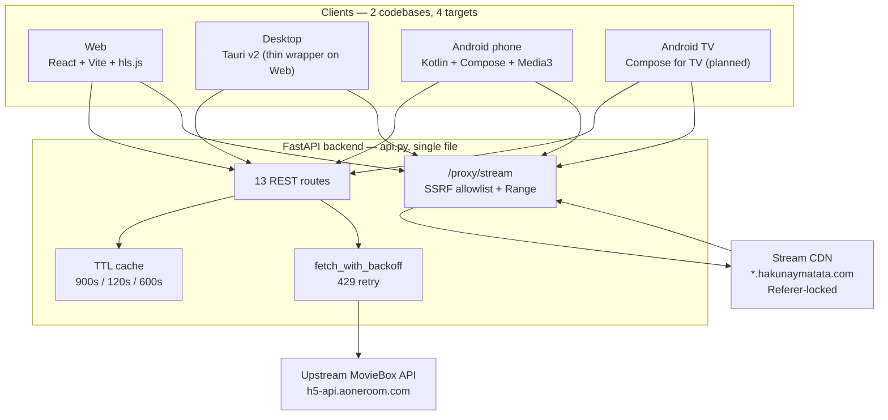

# Architecture

> One-page system map. Deep dives live in [`docs/Architecture/`](docs/Architecture/)
> and the decision record is in [`docs/Decisions/`](docs/Decisions/).

---

## 1. The system



---

## 2. Why it is shaped this way

| Question | Answer | Record |
|----------|--------|--------|
| Why a proxy at all? | The CDN is Referer-locked and `<video>`/ExoPlayer cannot send a `Referer`. Relaying through the API injects the headers server-side. | [ADR-001](<docs/Decisions/ADR-001 Proxy for Referer-locked playback.md>) |
| Why `httpx` not `curl_cffi` for streaming? | The CDN doesn't pin TLS/JA3, and `curl_cffi`'s `.stream()` isn't a context manager — it threw a misleading 502. | [ADR-002](<docs/Decisions/ADR-002 httpx over curl_cffi for streaming.md>) |
| Why 2 codebases, not 4? | Tauri *is* the web app; TV *is* the Android app. Wrapping avoids rewrites while keeping native playback. | [ADR-003](<docs/Decisions/ADR-003 Two codebases.md>) |
| Why filter adults server-side? | One implementation, four clients, one default. Clients opt in. | [ADR-004](<docs/Decisions/ADR-004 Unfiltered adult content by default.md>) |
| Why no bundled backend? | Thin clients + user-supplied base URL → no Python sidecar, no packaging pain. | [ADR-005](<docs/Decisions/ADR-005 Remote self-hosted backend.md>) |

---

## 3. The two request paths

### Metadata path (cached)

```
client ──► /search, /detail, /episodes, /movies, /tv-series, /home
             │
             ├─ cache_get(key)  ── hit ──► return (32 ms warm)
             │
             └─ miss ──► fetch_with_backoff() ──► upstream ──► cache_set(ttl=900s)
```

Metadata is stable → **900 s TTL**. Cold measured **906 ms**, warm **32 ms**.

### Playback path (short-lived)

```
client ──► /api/stream/{id}[?se=][&ep=]     (resolve signed URLs, ttl=120s)
             │
             └─► returns CDN urls + quality ladder
                      │
client ──► /proxy/stream?url=<cdn_url>&referer=<domain>
             │
             ├─ scheme must be http/https          else 400
             ├─ is_proxyable(host) allowlist       else 403
             ├─ forward client's Range header
             └─ stream bytes ──► client <video> / ExoPlayer
```

Stream URLs are **signed with `&t=<epoch>` and expire in ~120 s**. They are
never persisted, never cached past `CACHE_TTL_STREAM`, and resolved at play time.

---

## 4. Backend layout (`api.py`, single file)

Read it top-down — everything above the routes is the engine.

| Region | Contents |
|--------|----------|
| Config | `PROXY_ALLOWED_HOST_SUFFIXES`, `WEB_DOMAINS`, UA strings, secrets |
| Helpers | `is_proxyable`, `cache_get/set`, `classify_subject_type`, `is_adult`, `strip_adult`, `fetch_with_backoff` |
| Signing | device id, `x-client-token`, `x-tr-signature`, canonical string |
| Upstream engine | `engine` class: search/detail/episodes/stream/catalog |
| HTML | embedded dashboard served at `/` |
| Routes | 13 `@app.get(...)` handlers |

**Contracts:** [`docs/Reference/API Endpoints.md`](<docs/Reference/API Endpoints.md>)

**Endpoint inventory (13):** `/` · `/search` · `/search/suggest` · `/detail/{id}` ·
`/episodes/{id}` · `/api/stream/{id}` · `/api/stream/{id}/captions` ·
`/proxy/stream` · `/proxy` · `/health` · `/movies` · `/tv-series` · `/home`

---

## 5. Client layout

```
web/                          ← codebase #1
├── src/config.ts             runtime API base URL (localStorage `moviebox.apiBase`)
├── src/api.ts                typed calls, all through apiUrl()
├── src/App.tsx               routing + shell
├── src/Settings.tsx          base-URL modal, probes /health before saving
├── src/Player.tsx            adaptive quality + manual picker
├── src/styles.css            design tokens
└── src-tauri/                ← desktop target: thin Tauri v2 shell on the same app

android/                      ← codebase #2
├── app/src/main/java/com/moviebox/app/
│   ├── data/    Config · Models · Api        (mirrors api.ts)
│   ├── player/  QualityLogic                 (pure, JVM-testable)
│   └── ui/      nav · theme · screens
└── app/src/test/             QualityLogicTest (17 tests, pure JVM)
```

---

## 6. Adaptive quality

Both clients share one model, implemented twice (once per language):

| Mode | Behaviour |
|------|-----------|
| **Auto** | Steps up when buffer ≥ `GOOD_BUFFER_SEC`; steps down when the player stalls. Signal is **buffer health**, not bandwidth probing. |
| **Manual** | User pins a rung (1080/720/480/360); adaptation suspends. |

- Web: `web/src/Player.tsx` — `hls.js` / `dash.js` level switching
- Android: `android/.../player/QualityLogic.kt` — `Player.VideoSize` + Media3 track selection
- Tests: `tests/test_backoff.py` (transport), `QualityLogicTest.kt` (17 JVM tests)

Why buffer-driven and not byte-counted: see [ADR-tier note](<docs/Architecture/Adaptive Quality.md>)
and `mem:architecture/android_build`.

---

## 7. Configuration model

| Setting | Where | Scope |
|---------|-------|-------|
| API base URL | `localStorage.moviebox.apiBase` / `SharedPreferences` | per client instance, user-editable in Settings |
| Adult filter | query param `include_adult` | per request, default `false` |
| Port | `$PORT` (shell, used by Procfile/Railway) | deployment only |

**There are no Python-side environment variables.** That is intentional: the
backend is config-free so it can be run by anyone with `pip install` +
`uvicorn api:app`. See [ADR-005](<docs/Decisions/ADR-005 Remote self-hosted backend.md>).

---

## 8. Trust & security boundary

```
┌─ untrusted ──────────────────────────────────────┐
│  any HTTP client, no auth                        │
└──────────────┬───────────────────────────────────┘
               ▼
┌─ app ────────────────────────────────────────────┐
│  validate scheme (http/https)        → 400       │
│  is_proxyable(host) allowlist        → 403  ◄── SSRF boundary
│  forward Range                       → 206       │
└──────────────┬───────────────────────────────────┘
               ▼ allowlisted hosts only
┌─ upstream / CDN ─────────────────────────────────┐
│  Referer + Origin + UA injected server-side       │
└──────────────────────────────────────────────────┘
```

The allowlist is the **only** thing preventing `/proxy` from becoming an open
relay to loopback, RFC1918, or cloud metadata endpoints. It is covered by
`tests/test_proxy_security.py`.

The API carries **no authentication and no user data** by design — see
`docs/Risks and Compliance.md` before attaching anything sensitive to it.

---

## 9. Current state

| Target | State |
|--------|-------|
| Backend | ✅ complete, verified live, 129 unit tests green |
| Web | ✅ complete, `tsc` + build green, 206 verified end-to-end |
| Tauri | 🟡 scaffolded + icons; blocked on Rust/MSVC install |
| Android phone | 🟡 written, **never compiled**; blocked on Android SDK |
| Android TV | ⬜ not started |

Live board: [`docs/Project/Status.md`](<docs/Project/Status.md>)
