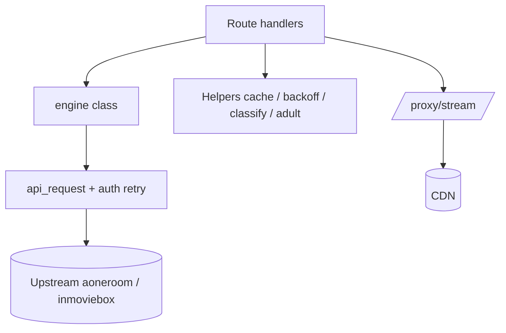

# Backend — `api.py`

> [!info] Single file, FastAPI
> Routes live at the **bottom** of the file. Everything above is the `engine` scraper class + helpers. Read [[Project/Overview]] first.

## Layer map



## `engine` class

- **`bootstrap_token(force=False)`** — anonymous token from `apig.inmoviebox.com`.
- **`api_request(method, path, …)`** — relays; on `401`/`441` forces a fresh token and retries **once**.
- **`search(query, page, per_page)`** — POST `/wefeed-mobile-bff/subject-api/search`.
- **`get_details(subject_id)`** — GET `…/subject-api/get`.
- **`get_episodes(subject_id)`** — GET `…/subject-api/season-info`. Returns `season` / `episode_count` / `resolutions`.
- **`get_streams(subject_id, season, episode)`** — resolves Web CDN + Web DASH + Mobile Native streams, sorted `quality_value` desc.
- **`get_subtitles(…)`** — GET `…/subject-api/get-stream-captions`.

## Added helpers (do not duplicate)

| Helper | Purpose |
| --- | --- |
| `classify_subject_type()` | 1 Movie · 2 Series · 3/6 Anime · 7 ShortDrama · 8 Promo — see [[Reference/Subject Types]] |
| `is_adult()` / `strip_adult()` | token match: adult, erotic, porn, xxx, hentai, 18+ |
| `cache_get` / `cache_set` | TTL dict cache + `threading.Lock` |
| `fetch_with_backoff()` | retries on 429, exp backoff + jitter |
| `is_proxyable()` | host-suffix allowlist check |
| `_catalog(tab_id, …)` | shared by `/movies` (tabId 2) and `/tv-series` (tabId 5) |

## Cache TTLs

| Constant | Value | Applies to |
| --- | --- | --- |
| `CACHE_TTL_METADATA` | 900s | search, detail, episodes, catalog |
| `CACHE_TTL_STREAM` | 120s | signed stream URLs — **they expire** |
| `CACHE_TTL_SUGGEST` | 600s | autocomplete |

> [!warning] Never raise `CACHE_TTL_STREAM`
> Stream URLs carry `&t=<epoch>`. Past expiry they fail at *fetch* time, not resolve time.

## Endpoints

Full table: [[Reference/API Endpoints]].

```
/search          /search/suggest     /detail/{id}
/episodes/{id}   /api/stream/{id}    /api/stream/{id}/captions
/movies          /tv-series          /home
/proxy/stream    /proxy              /health
```

## Gotchas

- **`/home` is passed through raw** — no shaping, no caching.
- **`curl_cffi` Session is blocking** — uvicorn runs handlers in a threadpool.
- **`/movies` + `/tv-series` were 25 duplicated lines each** — both now call `_catalog()`. Keep it that way.
- Response keys are **snake_case** (`subject_id`, `is_adult`, `release_date`).

## Related

→ [[Architecture/Stream Proxy]] · [[Guides/Verification]] · [[Guides/Debugging Upstream]]
