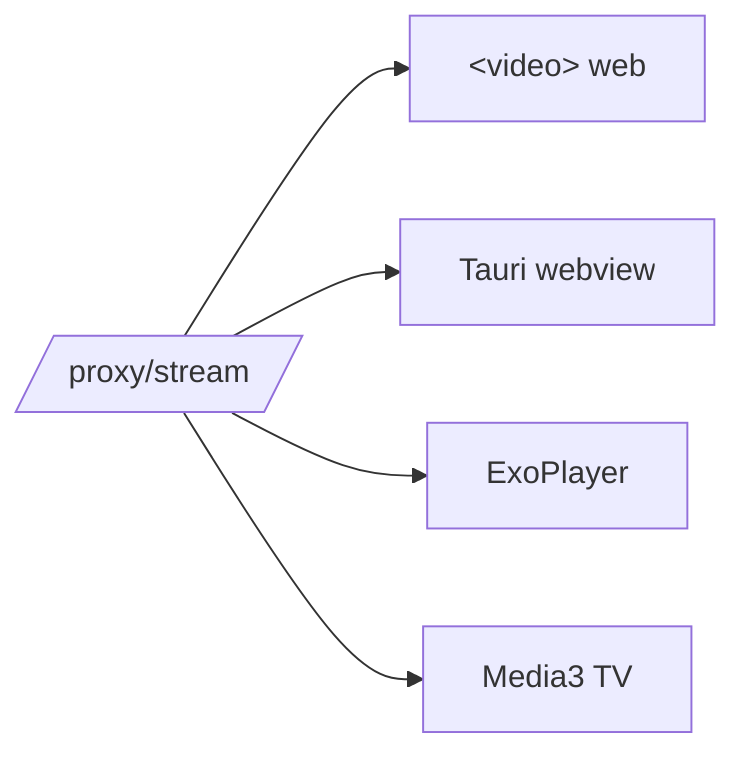

# Client Strategy — 2 codebases, not 4

> [!abstract] The decision
> Web + desktop share **one React app**. Android phone + TV share **one Kotlin app**. Backend was built first because every client depends on it.

## Why not one codebase for all four?

A WebView APK would *work* but plays video **badly** — no hardware DASH, weak seeking, battery drain. Android TV additionally needs real D-pad focus handling. So:

| Target | Stack | Rationale |
| --- | --- | --- |
| **Web** | React + Vite + hls.js/dash.js | SPA is enough; skip SSR — buys nothing for a video app ✅ **done** |
| **Desktop** | **Tauri** wrapping `web/dist` | ~10 MB vs Electron ~150 MB; near-zero new UI |
| **Android phone APK** | Kotlin + Compose + **Media3/ExoPlayer** | ExoPlayer handles DASH, signed URLs, headers properly |
| **Android TV** | Kotlin + **Compose for TV** (Leanback) + Media3 | 10-foot UI, D-pad nav, focus rings — genuinely different UX |

## Why the proxy makes this cheap

Because [[Architecture/Stream Proxy]] normalizes **Referer + Range + CORS**, every client consumes the **same URL with a plain player**. No per-platform header logic.

## Status

- ✅ Web — see [[Architecture/Adaptive Quality]]
- ⬜ Desktop — [[Roadmap/Tauri Desktop]] ← next
- ⬜ Android — [[Roadmap/Android]]

## Open decision (blocks Android + packaging)

> [!question] Backend hosting
> Bundle the Python API **inside** the desktop app, or point clients at a **self-hosted/remote** API?
>
> Affects: APK size · update flow · whether the proxy relays copyrighted bytes through *your own server* — see [[Risks and Compliance]].

## Risks carried into Android

- ExoPlayer needs the proxy URL and **no custom headers** (the proxy handles it).
- Stream URLs **expire** — resolve at play time, never persist to disk.
- Upstream `429`s — backend already backs off; client should surface a retry.

## Related

→ [[Decisions/ADR-003 Two codebases]] · [[Reference/API Endpoints]] · [[Risks and Compliance]]
