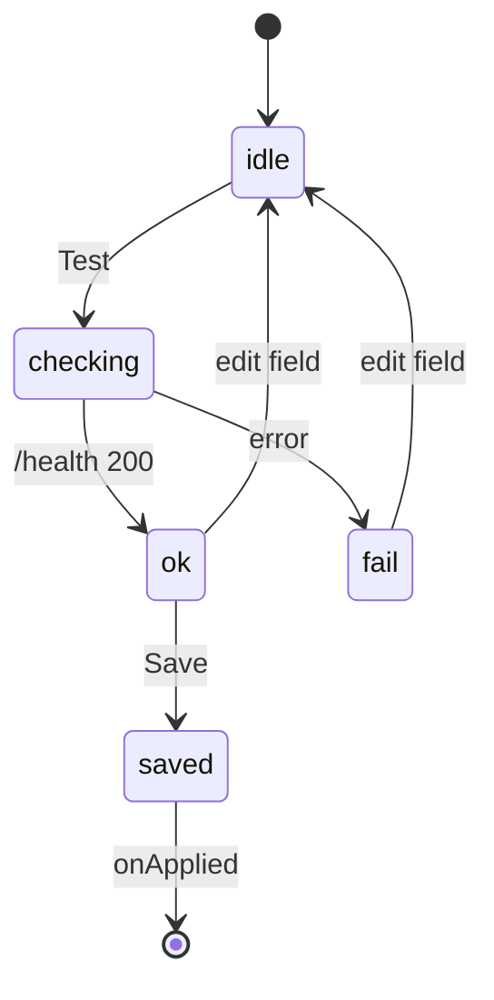

# Runtime Config — API base URL

> [!info] Why this exists
> Per [[Decisions/ADR-005 Remote self-hosted backend]], clients are **thin** and point at a user-supplied API host. This module is how.

## `web/src/config.ts`

| Export | Behaviour |
| --- | --- |
| `getApiBase()` | Reads `localStorage["moviebox.apiBase"]`, cached in a module var. **Empty string = same origin.** |
| `setApiBase(raw)` | Normalizes (strips trailing `/`), persists. Pass `""` to reset to same-origin. |
| `apiUrl(path)` | `path` when base empty, else `base + path`. **The only place the base is joined.** |
| `checkHealth(ms)` | `AbortController` probe of `/health`. Returns a result object — **never throws**. |
| `isTauri()` | `'__TAURI_INTERNALS__' in window`. |

`normalize()` strips trailing slashes so path joining never produces `//`.

## `web/src/Settings.tsx`

Modal (⚙ in the topbar) with **Test** / **Save**.

Probe states are a **discriminated union**: `idle | checking | ok | fail`.

> [!tip] Probe safety
> `test()` applies the draft, probes, and **reverts on failure** — so a bad host is never persisted. Preserve this.

`onApplied` (in `App.tsx`) clears `results`/`detail`/`streams`, resets to home, and re-runs the current query against the new host.

## Downstream impact

`web/src/api.ts` routes **both** `getJSON()` and `proxiedUrl()` through `apiUrl()`.

> [!danger] Invariant
> Never build playback URLs from `window.location.origin` — with a remote backend that points the video at the wrong host. See [[Architecture/Stream Proxy]] for why the proxy path matters.

## Gotchas

- The ⚙ button's `title` doubles as a status readout: `API: <base>` or `API: same origin`.
- Empty base is a **first-class state** — it's what the Vite dev proxy *and* any reverse-proxied deploy use. Don't assume a non-empty base.
- Styles: `.modal*`, `.icon-btn`, `.btn-ghost`, `.btn-primary` in `styles.css`.

## Related

→ [[Decisions/ADR-005 Remote self-hosted backend]] · [[Architecture/Client Strategy]] · [[Reference/Commands]]
