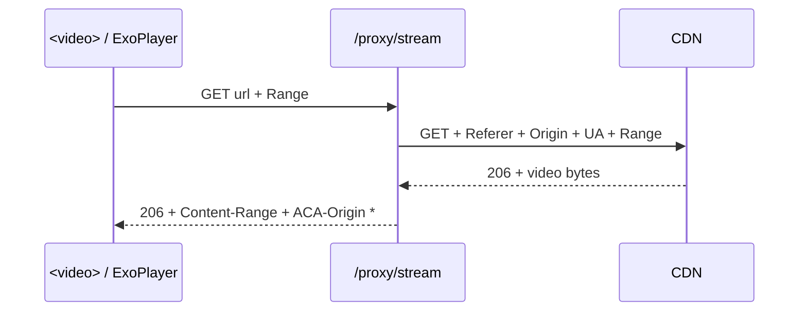

# Stream Proxy — `/proxy/stream`

> [!success] The crown jewel
> This is the single most important addition. Without it, no browser, desktop, or TV client can play anything. **Read before touching playback.**

## Why it exists

The video CDN (`bcdnxw.hakunaymatata.com`) is **Referer-locked** to the source domain (e.g. `https://123moviesfree.club/`).

A browser `<video>` element **cannot set a Referer header** → direct playback 403s.

The proxy relays the bytes and forwards `User-Agent` + `Referer` + `Origin`, so **every client plays through one URL with zero custom headers**. This is what makes the 2-codebase strategy ([[Architecture/Client Strategy]]) viable.



## Verified facts

> [!tip] Non-obvious, hard-won
> - **The CDN does NOT pin TLS/JA3 on video bytes.** Proof: a plain `.NET` `HttpWebRequest` (Schannel stack, totally different JA3 from Chrome) fetched them fine — *as long as* Referer/UA were present.
>   → The proxy therefore uses **`httpx`, not `curl_cffi`**. See [[Decisions/ADR-002 httpx over curl_cffi for streaming]].
> - CDN sets `Access-Control-Allow-Origin: *` on video responses.
> - `Accept-Ranges: bytes` is present → seeking works.

## The bug that cost time

> [!failure] Do not repeat
> `curl_cffi` `.stream()` returns a **generator**, not a context manager. Calling `resp_cm.__enter__()` throws — which surfaced as a **misleading `502 Bad Gateway`**.
>
> `httpx.stream()` *is* a real async context manager, which is why it's the correct tool here.

## Contract

```
GET /proxy/stream?url=<encoded_url>&referer=<domain>
```

- `url` must pass `is_proxyable()` — allowlist `PROXY_ALLOWED_HOST_SUFFIXES`:
  `hakunaymatata.com`, `aoneroom.com`, `moviebox.ph`, `inmoviebox.com`. Else **403**.
- Forwards the client's `Range` upstream; returns `206` + `Content-Range` + `Accept-Ranges`.
- Emits `Access-Control-Allow-Origin: *` and `Expose-Headers` for `Content-Length`/`Content-Range`/`Accept-Ranges`.
- Streams in **256 KiB** chunks; closes the upstream CM in a `finally`.

## Invariant

> [!danger] SSRF control
> The allowlist is a security control. **Never** widen it to arbitrary hosts, and never accept a full URL from an unvalidated source. Removing it turns the API into an open SSRF relay.

## Verification bar

> [!warning] A bare `200` is insufficient
> You must assert **`206` + `Content-Range`** to prove seeking works. See [[Guides/Verification]].

## Related

→ [[Decisions/ADR-001 Proxy for Referer-locked playback]] · [[Architecture/Adaptive Quality]] · [[Reference/API Endpoints]]
