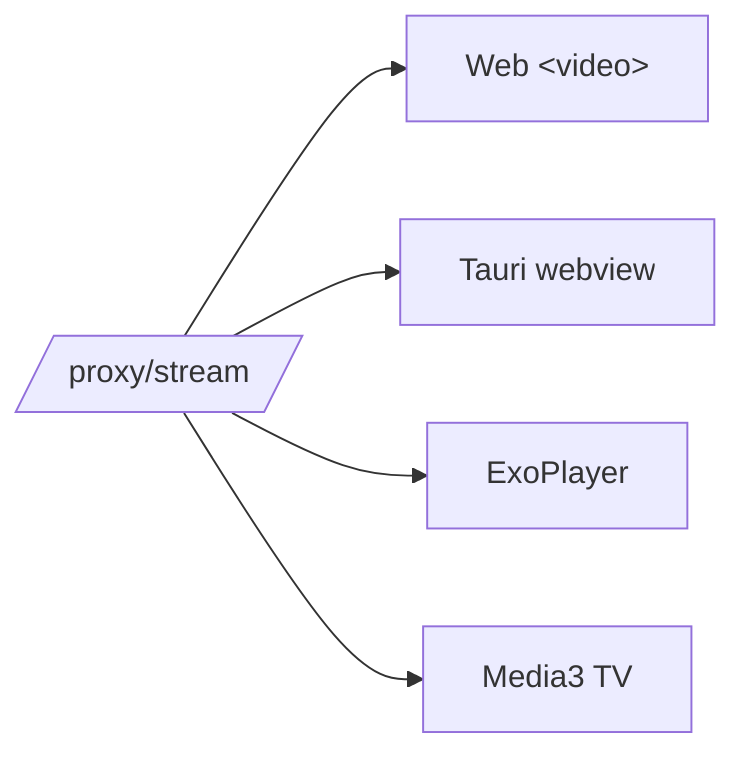

# ADR-003: Two codebases, not four

## Status

✅ **Accepted** — user-selected (chose native Kotlin for Android).

## Context

Four targets requested: **web · desktop · TV · movie APK**. The naive read is four apps. But web and desktop are nearly the same runtime, and Android phone and TV share a platform.

The deciding technical factor: WebView-based Android video playback is **poor** — no hardware DASH, weak seeking, battery drain — and Android TV needs real D-pad focus handling that a web view won't give.

## Decision

| Codebase | Targets | Stack |
| --- | --- | --- |
| **1** | Web + Desktop | React + Vite (+ hls.js/dash.js); desktop = **Tauri** shell wrapping `web/dist` |
| **2** | Android phone + TV | Kotlin + Jetpack Compose + **Media3/ExoPlayer**; TV uses **Compose for TV** (Leanback) |

## Rationale

- **Tauri over Electron** — ~10 MB vs ~150 MB; the web app is reused verbatim.
- **Native Android over WebView** — ExoPlayer handles DASH, signed URLs and headers properly; Compose-for-TV gives genuine 10-foot UX.
- **Backend first** — every client depends on it, and it had live bugs. See [[Project/Status]].

## Why this is affordable at all

[[ADR-001 Proxy for Referer-locked playback]] normalizes **Referer + Range + CORS** into a single URL. ExoPlayer, `<video>`, and a Tauri webview all consume it **identically** — no per-platform header logic.

## Consequences

> [!success] Positive
> - No duplicated product logic between phone and TV.
> - Desktop ships almost free once web is done.
> - Player logic written once for web+desktop.

> [!risk] Negative
> - Kotlin/Compose is a **genuinely separate** skill tree and build system (Gradle, SDK).
> - TV focus/nav is real UX work, not a stylesheet.
> - Two toolchains to keep alive.

## Open follow-on

**Backend hosting** — bundle the Python API inside the desktop app, or point clients at a self-hosted/remote API? Affects APK size, update flow, and legal exposure. Unresolved; see [[Risks and Compliance]].

## Related

→ [[Architecture/Client Strategy]] · [[Roadmap/Tauri Desktop]] · [[Roadmap/Android]] · [[ADR-001 Proxy for Referer-locked playback]]
