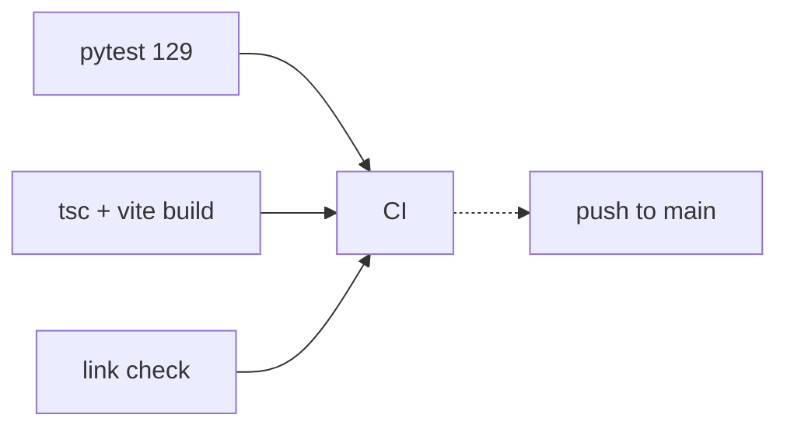

# 🎬 MovieBox — Map of Content

> [!info] Start here
> This vault is the single source of truth for the MovieBox project. Open the **graph view** to see how everything connects.

---

## 🧭 Orientation

| If you want to… | Read |
| --- | --- |
| Understand what this is | [[Project/Overview]] |
| Know what works right now | [[Project/Status]] |
| Run it locally | [[Reference/Commands]] |
| Ship a change safely | [[Guides/Verification]] |
| Change code responsibly | `rules.md` (repo root — invariants) |
| Understand the system | `architecture.md` (repo root — one page) |
| Style something | `design.md` (repo root — shared tokens) |
| See every root file | [[Reference/Project Files]] |
| Commit without breaking things | [[Guides/Git Workflow]] |
| Debug something broken | [[Guides/Debugging Upstream]] |

---

## 🏗️ Architecture

- [[Architecture/Backend]] — the single-file FastAPI scraper
- [[Architecture/Stream Proxy]] — ⭐ the piece that makes playback possible
- [[Architecture/Adaptive Quality]] — auto + manual player logic
- [[Architecture/Client Strategy]] — why 2 codebases, not 4
- [[Architecture/Runtime Config]] — runtime API base URL + settings UI

## 🧾 Reference

- [[Reference/API Endpoints]] — every route, params, shapes
- [[Reference/Subject Types]] — the 1/2/3/6/7/8 taxonomy
- [[Reference/Commands]] — Windows-native command cheatsheet
- [[Reference/Project Files]] — every repo-root file and why it exists

## 🛠️ Guides

- [[Guides/Verification]] — what must be green before you claim "done"
- [[Guides/Git Workflow]] — the gitignore traps that almost shipped broken commits
- [[Guides/Debugging Upstream]] — when the source itself misbehaves

## 🧠 Decision Records

- [[Decisions/ADR-001 Proxy for Referer-locked playback]]
- [[Decisions/ADR-002 httpx over curl_cffi for streaming]]
- [[Decisions/ADR-003 Two codebases]]
- [[Decisions/ADR-004 Unfiltered adult content by default]]
- [[Decisions/ADR-005 Remote self-hosted backend]]

## 🗺️ Roadmap

- [[Roadmap/Tauri Desktop]] ← blocked on Rust/MSVC (icons ✅ done)
- [[Roadmap/Android]] ← written, needs SDK to compile
- [[Roadmap/Backlog]]

## ⚠️ Risk

- [[Risks and Compliance]]

---

## 📊 Status at a glance

```mermaid
graph LR
    A[Upstream API] --> B[FastAPI backend]
    B --> C[/proxy/stream]
    C --> D[Web React]
    C --> E[Tauri Desktop]
    C --> F[Android APK]
    C --> G[Android TV]
    D -.done.-> D
    E -.needs Rust.-> E
    F -.needs SDK.-> F
    G -.planned.-> G
```

- ✅ Backend — complete & verified · **129 unit tests**
- ✅ Web frontend — complete & verified
- ✅ Tauri scaffold + icons — blocked only on Rust/MSVC install
- 🟡 Android phone APK — written, uncompiled (no SDK)
- ⬜ Android TV — not started
- ✅ Repo hygiene — `rules`/`architecture`/`design`/`AGENTS`/`SECURITY` + CI + link checker · 9 commits local



> [!tip] Related
> Serena holds the agent-facing memory graph (`mem:core` is its root). This vault is the human-facing mirror. Keep them in sync — see [[Guides/Verification]] § Memory sync.
