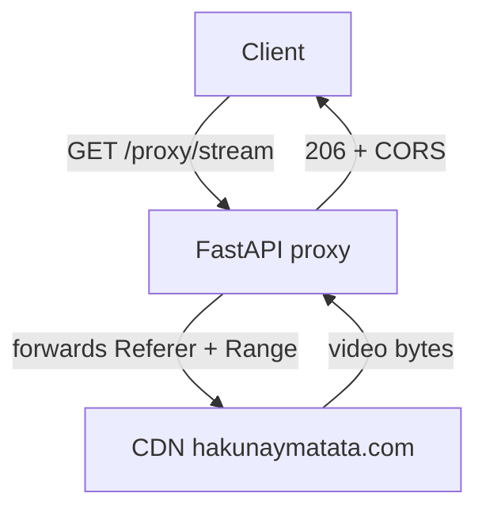

# Project Overview

> [!abstract] One-liner
> A scraper/proxy API over the **MovieBox** catalog, plus a multi-platform client suite. It does **not** host content — it resolves metadata and direct stream URLs from upstream and relays the bytes.

## What it actually is

Not a streaming service. It reverse-proxies MovieBox's own mobile + web backend (`wefeed-mobile-bff` endpoints on `moviebox.ph`), obtaining an anonymous bootstrap token, then relays search/metadata/stream-resolution requests and decodes signed CDN tokens so clients get direct MP4/DASH URLs.

**Crucially:** the repo is MIT-licensed *code*. That license does **not** cover the copyrighted content it indexes. See [[Risks and Compliance]].

## Repo layout

```
moviebox/
├── api.py            # the entire backend (single file, FastAPI)
├── main.py           # uvicorn entrypoint wrapper
├── requirements.txt  # fastapi, uvicorn, httpx, curl_cffi
├── Procfile / railway.json / vercel.json
├── .venv/            # gitignored
├── web/              # React + Vite client  ✅ built
│   └── src/{api,App,Player,styles,main}
└── docs/             # ← this vault
```

## Current state

| Layer | State |
| --- | --- |
| Backend | ✅ Complete & verified |
| Web frontend | ✅ Complete & verified |
| Tauri desktop | ⬜ Next |
| Android phone APK | ⬜ Planned |
| Android TV | ⬜ Planned |

Full detail: [[Project/Status]].

## Upstream hosts

| Role | Host |
| --- | --- |
| Web BFF | `h5-api.aoneroom.com` |
| Mobile native | `api3.aoneroom.com` |
| Auth bootstrap | `apig.inmoviebox.com` |
| Stream CDN | `*.hakunaymatata.com` |

## The load-bearing insight

The stream CDN is **Referer-locked**, and a browser `<video>` tag *cannot* send a Referer header. Without intervention, no web/desktop client can play anything. The entire architecture pivots on [[Architecture/Stream Proxy]].



## Navigation

→ [[Architecture/Backend]] · [[Architecture/Stream Proxy]] · [[Architecture/Client Strategy]]
